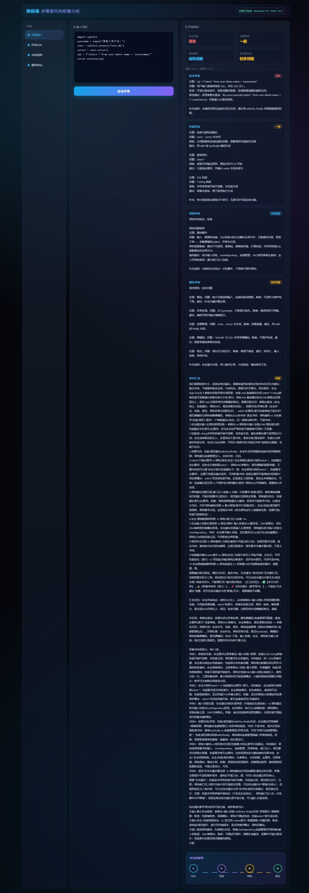
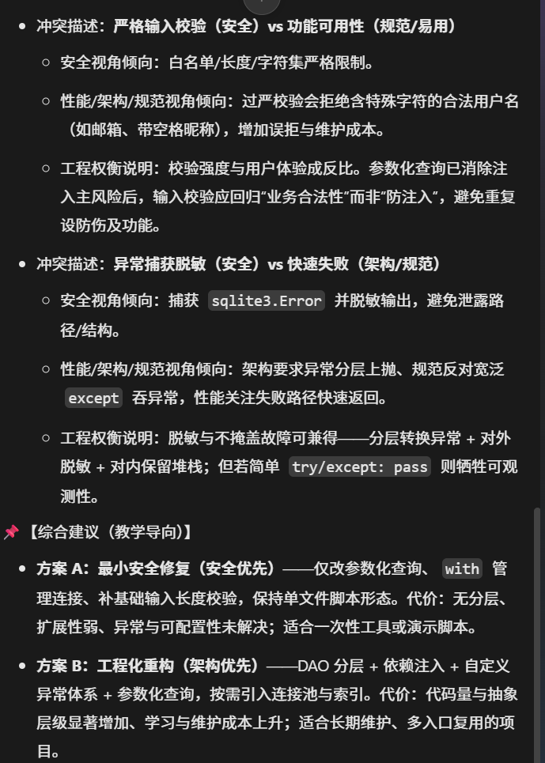

<div align="center">

# 辩码场 · BianMaChang

**把「安全 vs 性能 vs 架构 vs 规范」的矛盾摆到台面上，而不是给你一个标准答案。**

多智能体代码评审教学工具 ｜ 4 个评审 Skill 并行 ｜ 1 个冲突消解 Skill 汇总




</div>

---

## 这是什么

软件工程课上，教材和普通 AI 代码助手都习惯给出「最优解」。但真实开发里，安全和性能经常打架，架构优雅和交付进度经常打架——**很多问题没有唯一正确答案，只有可解释的取舍**。

辩码场把代码评审拆成四个互不干涉的智能体，让它们各说各话，再由第五个智能体专门负责「吵架后的清算」：

| Skill | 只关心 | 明确不看 |
|---|---|---|
| `security-review` | 注入、越权、敏感信息暴露（带 CWE 编号） | 性能、分层、命名 |
| `performance-review` | 连接开销、全表扫描、内存放大 | 安全、架构 |
| `architecture-review` | 职责边界、依赖倒置、可替换性 | 具体实现细节 |
| `standard-review` | 命名、注释、异常处理、类型注解 | 性能与架构 |
| `conflict-summary` | **识别前四者的分歧，输出互斥方案与各自代价** | 不判定谁对谁错 |

关键在第五个：它被明确约束为**不下结论、只呈现权衡代价**，输出「主张 A / 主张 B / 工程权衡说明 / 多套可选方案」。

## 一个真实例子

同一段 `get_user(username)` 代码，四个 Skill 给出的结论彼此冲突（以下为项目真实运行输出）：

> **安全**：S1 SQL 注入（Critical，CWE-89），必须参数化，不可妥协。
> **性能**：连接频繁开关，建议改用连接池复用。
> **架构**：五类职责挤在一个函数里，应抽 `UserReader` 端口 + 适配器。
> **规范**：`SELECT *` 与残缺 SQL 属规范问题，需补全并加类型注解。

冲突汇总 Skill 的判定：

> **安全修复（参数化）与性能建议（连接池）并不冲突，属双赢；**
> **但「连接池化」与「函数返回前自行 close 的自包含性」直接互斥** ——
> 主张 A 保持函数自包含，代价是放弃复用；
> 主张 B 把连接生命周期上移到应用层，代价是架构依赖方向改变。
> 两者无法同时满足，需按教学场景选择讨论立场。

<div align="center"></div>

> 这才是这个项目想让学生看到的东西：**四个都对，但没法同时都对。**

## 架构

```
                    ┌──────────────────────────────┐
   代码输入 ────────▶│  FastAPI 后端  backend/       │
                    │  /api/review（SSE 流式）      │
                    └──────────────┬───────────────┘
                                   │ asyncio 并发
        ┌──────────┬──────────┬────┴─────┬──────────┐
        ▼          ▼          ▼          ▼          │
   security   performance  architecture  standard    │
        │          │          │          │          │
        └──────────┴────┬─────┴──────────┘          │
                        ▼                            │
                 conflict-summary ◀──────────────────┘
                        │
                        ▼
        结构化输出：共识项 / 冲突项 / 互斥方案 + 代价
                        │
                        ▼  SSE 逐条推送（谁先完成谁先显示）
                  前端四卡点亮 + 冲突权衡带动画
```

- **Prompt 与码道平台完全同源**：后端直接读取 `skills/*/prompt.md`，一个字没改，只追加输出格式适配。
- **四路真并发**：`asyncio.gather` 同时发起，页面逐条点亮，不是等全部算完再一起吐。

## 快速开始

### 方式一：只看界面（零依赖）

双击 `index.html` 即可。此时为**离线演示模式**，使用内置样例结论，页面上会明确标注，不会伪装成真实结果。

### 方式二：本地真实评审（推荐）

```bash
cd backend
pip install -r requirements.txt
copy .env.example .env      # Windows；Linux/macOS 用 cp
# 在 .env 里填入 MAAS_API_KEY
python -m uvicorn main:app --host 127.0.0.1 --port 8000
```

打开 <http://127.0.0.1:8000> ，粘贴代码，点「启动评审」。四路评审并发返回，约 20–60 秒（视模型负载），页面右上角显示当前模式。

Windows 用户可直接双击 `backend/run.bat`。

### 方式三：在码道平台复现原始流水线

1. 按 `codearts_proof/skill_prompt/*/prompt_final.md` 在华为云码道创建 5 个 Skill；
2. 按 `codearts_proof/screenshot/agent_02_full_pipeline_demo*.png` 编排「4 路并行 + 汇总串接」；
3. 粘贴 `testcases/` 中的代码运行，对照 `codearts_proof/run_log/` 的原始输出。

## 配置项

| 变量 | 默认值 | 说明 |
|---|---|---|
| `MAAS_API_KEY` | 空 | 华为云 ModelArts Studio API Key；为空则自动回放 |
| `MAAS_BASE_URL` | `https://api.modelarts-maas.com/openai/v1` | OpenAI 兼容端点 |
| `MAAS_MODEL` | `deepseek-v4.1-flash-1017` | **白名单硬约束**，配置其他模型会拒绝启动 |
| `MODE` | `auto` | `maas` 强制真实 / `replay` 强制回放 / `auto` 自动降级 |
| `REVIEW_TIMEOUT` | 120 | 单路超时（秒） |

## 目录结构

```
.
├── index.html                 # 前端（原生 HTML/CSS/JS，无框架）
├── backend/                   # 真实评审服务（FastAPI）
│   ├── main.py                #   /api/review（SSE）+ /api/health
│   ├── prompts.py             #   从 skills/ 载入 Prompt，不改原文
│   ├── providers.py           #   MaaS 真调用 / replay 回放 / 模型白名单
│   └── replay.json            #   离线回放数据（节选自真实运行记录）
├── skills/                    # 5 个 Skill 的双版本 Prompt（v1 → final）
├── testcases/                 # 4 份测试用例源码
├── codearts_proof/            # 码道开发证据链
│   ├── skill_prompt/          #   双版本 Prompt + 修改理由
│   ├── run_log/               #   9 次真实对话/流水线运行记录
│   ├── screenshot/            #   40+ 张过程截图
│   ├── testcase/              #   用例运行截图
│   ├── test_report.md         #   测试报告
│   ├── codearts_usage_summary.md
│   └── design_think.md        #   架构选型论证
└── docs/assets/               # README 配图
```

## 技术诚实说明（重要）

这个项目的边界我写清楚，避免任何误解：

- ✅ **5 个 Skill 在华为云码道平台上完成创建、Prompt 迭代、单 Skill 测试、流水线并行编排与端到端联调**，原始记录全部归档在 `codearts_proof/`。
- ✅ **后端真实调用大模型**（华为云 MaaS `deepseek-v4.1-flash-1017`），Prompt 与码道仓库同一份文件，四路并发、真实返回，结果不经预设。
- ❌ **后端没有调用码道 API**。码道未开放公开 API，本项目选择「Skill 服务化移植」路线：把码道验证过的 Prompt 搬进服务，让教学场景脱离 IDE 也能用。
- ❌ 不做「假装打通」的演示：离线模式下页面会明确标注"离线演示"，不会把样例数据伪装成实时结果。

## 当前局限

1. 冲突识别依赖大模型，极少数场景可能漏看细微分歧；
2. 测试用例以 Python 为主，尚未覆盖 Java / C++；
3. 后端单机运行，未做多用户并发与鉴权（教学 demo 用途）；
4. 等级判定（高危/中/低）为规则启发式，用于指标卡快速呈现，正文才是权威结论。

## 后续规划

- [ ] 把冲突类型沉淀成可检索的教学案例库（按「注入 vs 索引」「解耦 vs 性能」等模式组织）
- [ ] 多语言支持与更细粒度的冲突定位
- [ ] 教师端：课堂投屏模式 + 学生分组立场辩论记录

---

<div align="center">

**2026 华为开发者大赛 · 智能体创新赛（西南赛区）· 高校组**

如果这个思路对你有用，欢迎 Star ⭐

</div>
